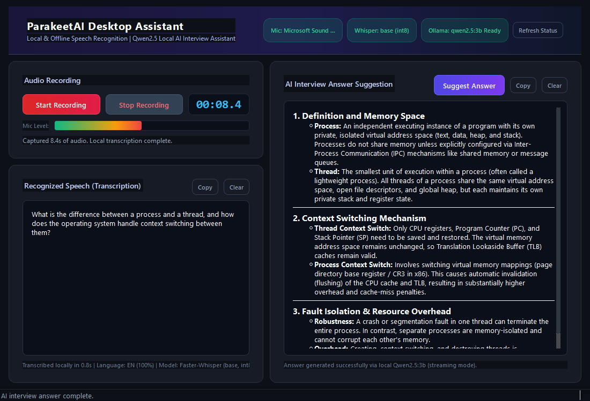
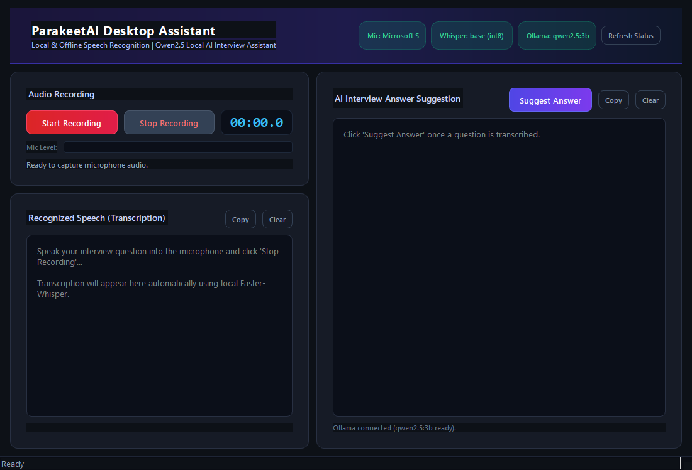

# ParakeetAI Desktop Assistant

<div align="center">
  <h3>Local, Offline AI-Powered Interview Assistant for Windows</h3>
  <p><em>Speech Recognition · AI Answer Generation · No Cloud APIs</em></p>
</div>

---

## Overview

**ParakeetAI Desktop Assistant** is a fully local, offline-capable Windows desktop application that:

1. Records your voice from the microphone
2. Transcribes it locally using [Faster-Whisper](https://github.com/SYSTRAN/faster-whisper) (base, CPU int8)
3. Sends the transcribed question to a local [Ollama](https://ollama.com) LLM (`qwen2.5:3b`)
4. Streams the AI-generated answer progressively in real time

All processing happens **on your machine**. No data is sent to the cloud. No paid APIs are used.

---

## Screenshots

### Application Interface — Active Technical Interview Workflow


### Initial Launch View


---

## Features

- 🎤 **Real microphone recording** with live audio level meter and elapsed timer
- 🔡 **Local speech-to-text** with Faster-Whisper base model (CPU, int8)
- 🤖 **Local AI answers** streamed token-by-token from Ollama `qwen2.5:3b`
- 🌙 **Modern dark UI** with blue/purple gradient accents, rounded cards, responsive layout
- 🧵 **Non-blocking architecture** — all heavy operations run in background QThreads
- 📋 **Copy & Clear** buttons for both transcription and AI answer panels
- 🔍 **Live status badges** for microphone, Whisper model, and Ollama server
- ⚠️ **Full error handling** for microphone failures, empty audio, missing model, Ollama offline

---

## Technologies

| Component | Technology | Version |
|---|---|---|
| Language | Python | 3.14.3 |
| Desktop UI | PySide6-Essentials | 6.12.0 |
| Audio Capture | SoundDevice | 0.5.5 |
| Signal Processing | NumPy + SciPy | 2.4.6 / 1.17.1 |
| Speech-to-Text | Faster-Whisper | 1.2.1 |
| LLM Runtime | Ollama | 0.40.13 |
| AI Model | Qwen2.5:3b | quantized |
| Packaging | PyInstaller | 6.22.3 |

---

## Project Architecture

```
ParakeetAI_Desktop_Assistant/
├── main.py                   # Application entry point
├── requirements.txt          # Python dependencies
├── README.md
│
├── audio/
│   ├── __init__.py
│   └── recorder.py           # Thread-safe AudioRecorder using sounddevice
│
├── speech/
│   ├── __init__.py
│   └── transcriber.py        # Faster-Whisper local STT engine
│
├── ai/
│   ├── __init__.py
│   └── ollama_client.py      # Local Ollama REST client with streaming
│
├── ui/
│   ├── __init__.py
│   ├── main_window.py        # PySide6 MainWindow + QThread workers
│   └── styles.py             # Dark theme QSS stylesheet
│
├── assets/
│   ├── app_icon.ico
│   └── app_icon.png
│
└── tests/
    ├── __init__.py
    ├── test_audio.py
    ├── test_transcription.py
    └── test_ai.py
```

---

## Prerequisites

### 1. Python 3.11+
Download from [python.org](https://www.python.org/downloads/) — Python 3.14 is confirmed working.

### 2. Ollama
Download and install from [https://ollama.com/download/windows](https://ollama.com/download/windows)

Or via winget:
```powershell
winget install --id Ollama.Ollama --accept-source-agreements --accept-package-agreements
```

### 3. qwen2.5:3b model (~1.9 GB)
```bash
ollama run qwen2.5:3b
```

### 4. Microphone
Any input microphone recognized by Windows audio system.

---

## Installation

```bash
# Clone or extract project
cd C:\Users\ELCOT\VoiceToText

# Install Python dependencies
pip install pyside6-essentials faster-whisper sounddevice numpy scipy requests pyinstaller
```

> **Note:** The Faster-Whisper `base` model (~150 MB) downloads automatically on first run from HuggingFace.

---

## Running the Application

### Step 1 — Start Ollama server (required each session)
```bash
ollama serve
```

### Step 2 — Launch ParakeetAI
```bash
cd C:\Users\ELCOT\VoiceToText
python main.py
```

---

## Usage Workflow

| Step | Action |
|---|---|
| 1 | Launch application — status badges show system health |
| 2 | Click **Start Recording** — speak your interview question |
| 3 | Click **Stop Recording** — Faster-Whisper transcribes locally |
| 4 | Review transcription in the left panel |
| 5 | Click **Suggest Answer** — Qwen2.5:3b streams an answer token-by-token |
| 6 | Copy or clear either panel as needed |

---

## Offline Functionality

After initial model downloads, the application works **completely offline**:

| Component | Download Once | Offline |
|---|---|---|
| Faster-Whisper base | ~150 MB from HuggingFace | ✅ |
| Ollama + qwen2.5:3b | ~1.9 GB | ✅ |
| PySide6, Python deps | pip install | ✅ |

---

## Building Windows EXE

```bash
cd C:\Users\ELCOT\VoiceToText
python -m PyInstaller ^
  --name "ParakeetAI" ^
  --onedir ^
  --windowed ^
  --icon assets/app_icon.ico ^
  --add-data "assets;assets" ^
  --hidden-import faster_whisper ^
  --hidden-import sounddevice ^
  --hidden-import ctranslate2 ^
  --collect-all faster_whisper ^
  --collect-all ctranslate2 ^
  main.py
```

Output: `dist/ParakeetAI/ParakeetAI.exe`

> **Important:** Ollama must be installed separately — it is not bundled into the EXE (its daemon runs as a system service).

---

## Troubleshooting

| Problem | Solution |
|---|---|
| `Ollama: Offline` badge | Run `ollama serve` in a terminal |
| `Missing qwen2.5:3b` badge | Run `ollama run qwen2.5:3b` |
| Microphone not detected | Check Windows Privacy Settings → Microphone |
| Whisper downloads on every launch | Set `HF_HUB_DISABLE_SYMLINKS_WARNING=1` env var |
| Empty transcription | Speak louder or closer to the microphone; check Mic Level bar |
| PySide6 import error | Run `pip install pyside6-essentials` |

---

## License

MIT License — Free for personal, academic, and commercial use.

